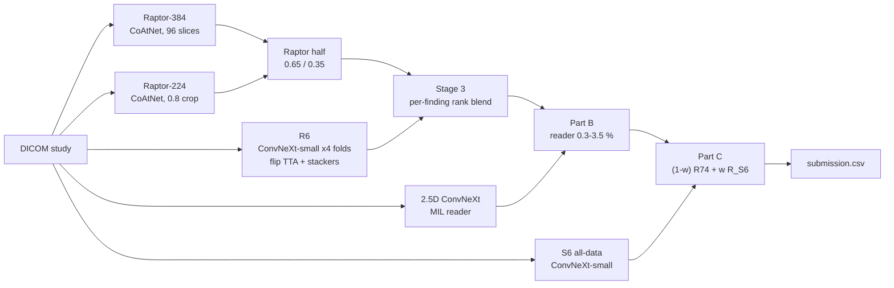

# RSNA Knee Abnormality Detection: ensemble and evaluation

Code, configs and write-up for team **Jay Gautam**'s solution to the Kaggle code competition
[RSNA Knee Abnormality Detection](https://www.kaggle.com/competitions/rsna-knee-abnormality-detection) (2026):
predict 12 findings (ligament and meniscus tears, osteoarthritis by compartment, effusion, synovitis, Baker's cyst,
contusion, fracture) from knee MRI studies. The metric is macro ROC-AUC over the 12 findings. Inference runs inside a
Kaggle notebook with no internet and a 9-hour limit.

| | |
|---|---|
| Best public score | **0.958** (v74, v89, v90) |
| Public rank before the final day | 381 of 6,361 teams |
| Final-day submissions | v94, v95, v96 A/B/C. See [docs/results.md](docs/results.md) |

## The problem in one paragraph

The training set has 4,407 studies, but **only 58 carry expert labels**. Every study has a free-text radiology report
in one of 10+ languages, so labels have to be mined from the reports. The 58 labelled studies are the only clean
yardstick, and they are positive-enriched. Our final-day work was mostly about using those 58 studies without fooling
ourselves. See [docs/evaluation.md](docs/evaluation.md).

## Final pipeline



All blending happens on percentile ranks, because the metric only sees order. Details, runtime budget and safety
guards: [docs/architecture.md](docs/architecture.md).

## What actually moved the score

* **Report mining with an LLM** (logit-scored yes/no questions, Qwen3) beat regex by +0.22 AUC on the 58 studies, and
  regex was at chance on non-English reports. ([research log](docs/research-log.md))
* **Strong public checkpoints, blended on ranks.** Our in-house models alone peaked at 0.906 public (August).
  Combining the public Raptor CoAtNets, the R6 compact ConvNeXt and the 2.5D reader reached 0.958.
* **A third model only helps if it is strong and different.** nartaa's S6 all-data model (0.950 alone) added a small
  gain at a 0.20 rank weight (v89 to v90 moved us up 87 places inside the 0.958 tie).
* **Final day: fix the Stage 3 weights that the labelled studies disagree with.** The inherited weights gave the
  Raptor half 85 % of Synovitis and 65 % of PF OA, while R6 (which never saw the 58) is clearly better on both.
  A split-half test (choose on 29 studies, score on the other 29, 600 times) supported reverting them.

Everything that did *not* work, and why: [docs/lessons.md](docs/lessons.md).

## Repository layout

| Path | Contents |
|---|---|
| `src/knee/` | Python package: `blend.py` (the notebook's blend maths), `metrics.py` (macro AUC, paired bootstrap, split-half test), `variants.py` (notebook builder), `labels/` (report-label mining), `io.py` |
| `pipeline/base/` | The v90 inference notebook (the submitted base), its Kaggle metadata, and readable copies of the embedded Part C and DICOM-reader code |
| `pipeline/variants/` | One JSON per submission variant: Stage 3 weights, S6 weight, deadlines, Kaggle provenance |
| `pipeline/eval/` | The gold-58 evaluation notebook (58 labelled + 46 other training studies scored end to end) |
| `scripts/` | `build_variant.py`, `validate_run.py`, `evaluate_gold58.py`, `split_half_cv.py`, leaderboard and runtime helpers |
| `tests/` | Unit tests (synthetic data only) and a repo-hygiene test that fails on credentials or competition IDs |
| `docs/` | Architecture, evaluation protocol, results, lessons, the full research log and submission history |
| `experiments/` | Archive of earlier kernels (caching, training, labelling, inference), Colab trainers and tools. Historical, not maintained |

## Quick start

```bash
pip install -e ".[dev]"
pytest -q                                   # 40+ tests, no competition data needed

# Build a submission notebook from a config, then push it to Kaggle
python scripts/build_variant.py pipeline/variants/v94.json --owner <kaggle-username> --out build/v94
kaggle kernels push -p build/v94

# After the commit run finishes: download its outputs and check them before submitting
kaggle kernels output <kaggle-username>/knee-infer-v94 -p runs/v94 --file-pattern '.*\.(csv|json)$'
python scripts/validate_run.py runs/v94 pipeline/variants/v94.json

# Evaluate every variant on the 58 labelled studies (needs the competition's train.csv and an eval-run output)
python scripts/evaluate_gold58.py runs/gold58 data/train.csv
python scripts/split_half_cv.py   runs/gold58 data/train.csv
```

The notebook's S6 parity check needs reference values for 3 public test studies. Those are competition data, so they
are not in this repo: put them in `pipeline/local/s6_parity.json` (gitignored) as `{study_uid: [12 probabilities]}`.
Without that file the notebook's commit run stops at the parity check on purpose.

## Data and safety policy

* No competition data (DICOMs, reports, labels, study IDs), no model weights and no credentials are committed.
  `tests/test_repo_hygiene.py` and a gitleaks job in CI enforce this on every push.
* Model weights are public Kaggle datasets, referenced by name in `pipeline/base/kernel-metadata.json`.
* Competition data is subject to the [competition rules](https://www.kaggle.com/competitions/rsna-knee-abnormality-detection/rules).

## Credits

This solution stands on public work by **nartaa** (Raptor CoAtNet SWA checkpoints, S6 all-data model),
**heliosli** (R6 compact ConvNeXt bundle, OrthoFoundation code), **goodpjw2008** (2.5D ConvNeXt MIL reader and the
public 0.958 recipe), **dreaddevelopment** (Raptor recipe) and **varshithakolupuri** (224-pixel stage). Weak-label
sources and the required OAI acknowledgement are listed in [NOTICE](NOTICE).

## License

Apache-2.0 for the code in this repository ([LICENSE](LICENSE)). Third-party code embedded in the notebooks keeps
its original license and attribution ([NOTICE](NOTICE)).
